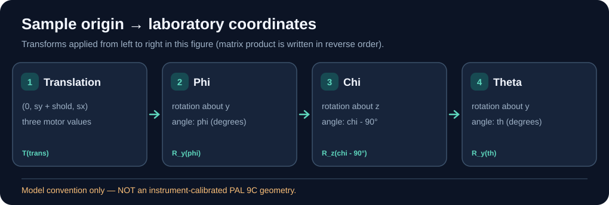

# 9c-sim

An early kinematic component of a **configurable beamline digital twin**. The PAL 9C sample stage is a concrete reference configuration, not a promise of one-to-one fidelity with the continuously evolving instrument. The current code answers one narrow question: given sample motor positions, where is the sample origin in the laboratory frame? The rocking-scan simulator is a separate repository (`rocking_xrd_sim`).

## Kinematic chain at a glance



The sample position is computed by applying the translation first, followed by phi, chi and th rotations.

In code, the product is `T(th) @ T(chi) @ T(phi) @ T(translation) @ [0, 0, 0, 1]`. Here `T(th)`, `T(chi)` and `T(phi)` denote rotation matrices. Verify real motor axes and signs before using lab coordinates.

## Scope and direction

- **Implemented today:** six-motor state, soft-limit checks, and one sample-stage homogeneous-transform chain.
- **Next:** separate generic frame/motor kinematics from beamline-specific configurations; validate configurations against available instrument references when appropriate.
- **Long-term:** configurable beamlines with beam, sample, detector, scans, and simulated measurements; reusable for research planning, education, and a beamline-scientist simulation game.
- **Boundaries:** instrument configuration and game/economy logic should not be hardcoded into the core kinematic mathematics. Keep any assumed geometry explicitly labeled; no claim that this is a calibrated PAL 9C instrument model.


- `motor.py`: `Motor` (pydantic) with a position and soft limits that are checked on every assignment; `BeamlineState` with the six motors `th`, `phi`, `chi`, `shold`, `sx`, `sy`; `MotorManager` with `move`, `get_pos` and a `wh` printout.
- `sample.py`: `Sample.get_global_pos`, the 4x4 homogeneous kinematic chain applied to the sample origin.

There is no detector arm, no q calculation and no diffraction calculation here. No 9C limit values are set: every motor defaults to minus to plus infinity, so the limit check only fires for limits you pass yourself.

## Geometry convention

The diagram above shows the **order applied to the sample-origin vector** (translation → phi → chi → th). For the same chain written in **matrix multiplication order**, see [the alternative transform diagram](docs/media/sample-chain.svg). Neither diagram is calibrated to the real 9C stage.

`get_global_pos` returns `T(th) T(chi) T(phi) T(translation)` applied to the sample origin `(0, 0, 0, 1)`, which is the chain `Lab <- th <- chi <- phi <- translation <- Sample`. Angles are in degrees; each rotation is right-handed about the axis named in the table, written in the frame of the stage it moves; lengths are in the unit of the motor positions (the code does not define one).

| Step | Motor | Operation |
|---|---|---|
| 1 (outermost) | `th` | rotation about the lab `y` axis by `th` |
| 2 | `chi` | rotation about `z` by `chi - 90` |
| 3 | `phi` | rotation about `y` by `phi` |
| 4 (innermost) | `sx`, `sy`, `shold` | translation by `(0, sy + shold, sx)`: `sx` moves along `z`, `sy` and `shold` both along `y` |

## Not established

The code is checked against its own chain (below). These points are **not** checked against the real instrument, because the facts about the 9C stage have not been supplied yet (open decision #2 in the author's decision list, "PAL 9C diffractometer geometry"):

- which lab axis is the beam, the vertical and the horizontal;
- the sign of each motor;
- why `chi` carries a 90 degree offset;
- whether `sx` is along `z` and `sy` and `shold` along the same `y` on the real stage.

Treat positions from this model as the model's, not as 9C positions, until those four are confirmed.

## Run

```bash
uv sync
uv run sample.py
```

This moves `shold` to 0.05 and `phi` to 180 and prints the sample origin in the lab frame, `[0.05, ~0, 0, 1]`.

## Test

```bash
uv run --with pytest pytest
```

Eight tests, about 2 seconds, numpy only. They compare `get_global_pos` with an independent construction (Rodrigues' formula) and check:

| Check | Tolerance | Result (2026-10-23) |
|---|---|---|
| each rotation matrix is a proper rotation over -360 to 360 degrees (`MᵀM = I`, `det = 1`) | 1e-12 | 2.2e-16 largest deviation in a separate run of the same check |
| the chain order matches the docstring for random motor states | 1e-12 | 3.6e-15 largest deviation, 1000 states, separate run |
| a point on the `th` axis does not move with `th`; a point on the `phi` axis does not move with `phi` | 1e-12 | 1.3e-15 largest deviation, separate run |

The "result" column comes from the pre-registered check the author's physics review ran on commit f1adc41 with scipy's `Rotation` as the independent implementation; `tests/test_sample.py` repeats the same three checks with numpy only and passes, and a swapped `th`/`chi` order in `sample.py` makes the order test fail. The tests establish that the code does what the docstring says; they cannot say that the docstring describes the real stage.

## Layout

```
motor.py            Motor, BeamlineState, MotorManager
sample.py           Sample and the kinematic chain
tests/test_sample.py
conftest.py         puts this directory on sys.path for the tests
```
